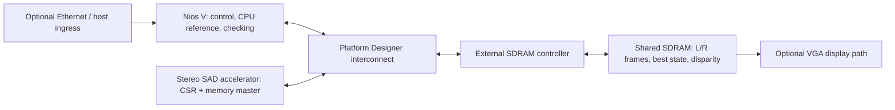

# Project Plan

[[Home]] → [[System Architecture]] → [[Accelerator Architecture]]

This is the **single active plan for current review and future implementation**. Separate placeholder notes are deliberately omitted. Implemented modules have their own explanations in [[Datapath Study Guide]]; a diagram or a proposed name is not evidence of implemented RTL.

**Paper-design views:** [[Paper Design Plan.canvas|Original accelerator block plan]] · [[Paper System Plan.canvas|Original whole-system plan]]. Recovered from the pre-cleanup canvases with their original layout and connections, not recreated from memory. They show the intended architecture; this note remains the source of current implementation status and acceptance gates.

## What exists

| Implemented module | Explanation | Source |
|---|---|---|
| Circular image-row buffer | [[Circular Row Buffer]] | `rtl/circular_row_buffer.sv` |
| Serial row RAM primitive (reference path) | [[Row RAM Bank]] | `rtl/row_ram_bank.sv` |
| Independent four-pixel word RAM | [[Row Word Bank]] | `rtl/row_word_bank.sv` |
| Packed-load circular row store | [[Packed Circular Row Buffer]] | `rtl/packed_circular_row_buffer.sv` |
| Stereo frontend datapath and aligned tags | [[Stereo Frontend - Code Walkthrough]] | `rtl/stereo_frontend.sv` |
| Matching left-column register | [[Left Column Delay]] | `rtl/left_column_delay.sv` |
| Whole-column right disparity cache | [[Right Column Shift Register]] | `rtl/right_column_shift.sv` |
| Pipelined column-SAD calculator | [[Pipelined Column SAD Calculator]] | `rtl/column_sad.sv` |
| Horizontal column-cost history | [[Column Sum Buffer - Code Walkthrough]] | `rtl/column_sum_buffer.sv` |
| One SAD engine: calculator + history | [[Single SAD Engine]] | `rtl/sad_engine.sv` |
| Pipelined minimum reduction | [[Minimum Comparator Tree - Code Walkthrough]] | `rtl/comparator_tree.sv` |
| Full fixed-disparity search and winner tags | [[SAD Search Backend]] | `rtl/sad_search_backend.sv` |
| Complete packed-load compute composition | [[Stereo SAD Datapath]] | `rtl/stereo_sad_datapath.sv` |

`circular_row_buffer_synth.sv` is the reduced synthesis smoke wrapper, not an additional functional datapath module. [[Verification Map]] links standalone benches and evidence. [[Column Pairing Verification]] verifies the delay/cache pairing only; it does not establish full frontend, lane-bank or board integration.

## Next steps and acceptance gates

**Current decision:** the packed frontend, fixed-search backend and complete compute composition exist, including parameterized spare rows. [[Integration Readiness]] separates observed compute evidence from the missing system integration. The serial reference is not extra hardware in the packed path; the original paper canvases are not implementation evidence.

1. **Review and simplify the existing datapath interactively.** Follow [[Datapath Study Guide]] from each module's system role to its widths/ports, startup and integration evidence. Use [[Hands-on Testbench Lab]] for practice; tool-run examples do not mark learner sessions complete. The user has authorized publishing the current snapshot for teammates; that does not mark interactive review complete or authorize unreviewed controller implementation.
2. **Confirm the current contract before adding control.** The [packed frontend contract](../docs/packed-frontend-contract.md) and [compute specification](../docs/accelerator-datapath-spec.md) already define coordinates, borders, packing, ties and handoffs. Review caller-owned readiness, active-bank lifetime and ordered spare promotion; do not add copies/FIFOs to solve a scheduling issue without evidence.
   - [[Control Emulation]] now exercises that contract with a test-only frame scheduler, independent protocol monitor and raw-image result sink. This is whole-compute-path simulation evidence, not delivery of the hardware controller in step 4.
3. **Prove the platform and transport in parallel.** Verify SDRAM from the selected Nios V setup, then CSR scratch/control and a stalled pass-through memory master before attaching the compute stream.
4. **Design the autonomous controller last.** After datapath review, specify and test ingress stopping, complete-row readiness, final-result drain and a separate horizontal clear edge. Existing bench scheduling is not that controller.
5. **Integrate, constrain and measure the board system.** Verify CPU/accelerator agreement, cache handling, timing closure and repeated frame batches. Report measured resource/performance trade-offs, not ideal scaling.

Every new functional HDL module must arrive with an exact-source, line-explained walkthrough and a registered standalone self-checking SV bench. Verify standalone behavior before integration. Do not create empty wrapper files merely to mirror this plan.

## Audited implementation queue

The serial row-storage block has been reviewed. Packed loading/frontend and the full fixed-search compute path are implemented; see [the compute contract and independent council decision](../docs/accelerator-datapath-spec.md). Their walkthroughs and observed evidence remain distinct from the future controller/transport gates below.

**Current user-authorized order:** independent council/spec first, complete compute-datapath components with an explanation after each, then interactive module-by-module simplification review and controller planning. The latest explicit request authorizes publishing the current project state; it supersedes earlier publication pauses, not the remaining implementation/review gates. Until hardware control exists, benches supply row pauses, complete-path drain gaps and scoped clears. That stimulus is not autonomous streaming/controller proof. Gate IDs identify acceptance obligations, not permission to claim integrated throughput.

**Two parallel tracks:** the **compute track is implemented and awaiting interactive review**; the **platform track remains unimplemented**. The system report makes Nios V access to the intended external SDRAM region the next platform action ([design_hierarchy.md, immediate next action](../docs/design_hierarchy.md#9-immediate-next-action)), followed by CSR and stalled pass-through transport. The gate IDs below are not a reason to defer that platform proof; connect the tracks only after each passes its own tests.

| Gate | Implementation work | Evidence required before moving on |
|---|---|---|
| **0 — compute contract specified; review open** | Paired column acceptance, bottom-right `(x,y)`, nonnegative disparity, common valid interior, row/frame clears, compile-time K/widths and tagged output are specified. | Review the existing port/width/timing contract and caller obligations before controller RTL. Runtime K/search reconfiguration is not silently included. |
| **1 — stereo frontend implemented** | `stereo_frontend`: two K+SPARE_ROWS packed stores, left delay/right cache and matching metadata. No FIFO or scheduler; engines/reducer remain outside this module. | Existing raw-image column/tap scoreboard covers independent L/R loads, spare writes, intact-window replay, warmup, bubbles, row boundaries, clear/restart and consumer-edge tags. See [[Stereo Frontend - Code Walkthrough]]. |
| **2 — serial full-width storage gate: passed and reviewed** | Clocked `row_ram_bank` instances, captured selector/newest bypass and explicit unused write-edge value preserve the serial reference interface. | Eight bank and ten row cases pass, including 640×480/641×480 streams; full-width synthesis reports 697 LE, 33 registers, 56,320 logical memory bits and 11 M9K nodes. This reviewed baseline is not the new packed-load interface; see the separate packed/frontend evidence. No fitting/timing/board claim. |
| **3 — one-lane compute integration implemented; controller last** | One-lane and nonzero-disparity behavior is covered through the implemented compute path under bench-driven row/frame controls. Review it before an autonomous controller. | Independent raw-pixel K×K windows, output count/tags, first/last windows, pauses, abort/restart and empty valid regions are tested. Bench drain/clear is datapath evidence only. The future controller must prove ingress stopping, last-row drain and horizontal-only clear while preserving active rows. |
| **4 — bank and reducer: RTL implemented** | [[SAD Search Backend]] owns existing engines, all-lane qualification, existing reducer and winner tags; [[Stereo SAD Datapath]] connects real packed storage. No output queue or ready signal is invented before transport requirements exist. Test 1, odd and 32 lanes. | Independent raw-window reference for every candidate/winner, lower-ID ties, same-coordinate checks, exact timing and row drains. Each engine receives early warmup columns. This is full fixed search only; partial-group/replay behavior is future work, not claimed coverage. |
| **5 — measure the chosen parallelism** | Fit/constrain **at least three feasible `P_LANES` builds** after functional equivalence, keeping K, search range and inputs identical. If a smaller bank searches a larger range, implement replay/group scheduling and best-state merge before comparing performance. | Actual logic/M9K/DSP use and TimeQuest slack at the declared clock for each build. Complete each build's throughput/speedup measurements after system integration; do not multiply a single-engine number by 32. |
| **6 — platform and transport; start in parallel now** | Prove the selected Nios V/toolchain/SDRAM combination, then CSR scratch/control, then a stalled pass-through Avalon memory master. Keep optional Ethernet/VGA outside the critical path. | Address/pattern/boundary tests, randomized waitrequest/read-response tests, stable stalled commands, FIFO safety, cache ownership and completion only after the final accepted write. |
| **7 — combined system** | Attach the independently verified compute stream to transport and software control; add the board wrapper and real constraints. | CPU/accelerator agreement on identical input frames, changing patterns and repeated batches without reprogramming. For at least three lane-count builds, report fitted resources/timing, total/active/stall cycles, throughput and end-to-end speedup under the same shared-SDRAM timing boundary. |

### Implemented packed frontend — contract summary

The user selected **independent four-pixel loads and column reads**, superseding the earlier serial-pixel wrapper proposal. This interface now exists; the summary is a review aid, not a request to build another wrapper. Full details: [packed frontend contract](../docs/packed-frontend-contract.md).

| Item | Current implemented contract |
|---|---|
| Parameters | `PIXEL_W`, `K`, `IMG_W`, `IMG_H`, `TAPS`, `SPARE_ROWS>=1`; bank width covers K+SPARE_ROWS and coordinate/index widths are at least one bit. Degenerate, odd and production-width shapes are tested. |
| Clock/reset | One clock; existing synchronous active-low `rst_n`. No invented CDC or asynchronous-reset behavior. |
| Input payload | Independent `left_write_valid_i`/`right_write_valid_i`, `left_write_data_i`/`right_write_data_i` (4P bits), common explicit `write_bank_i`/`write_word_i`. Low lane is the earliest of four adjacent pixels. Padding in a partial final word is never output. |
| Read acceptance | Shared `read_valid_i`, `read_x_i`, `read_y_i`, `read_oldest_i`. Caller guarantees K initialized active rows and contiguous accepted x; prefetch writes use spare banks and may share an active read's word address. Preserve active rows across bubbles; promote only after complete L/R readiness. No ready/FIFO/counters/ownership FSM. |
| Frame clear | Synchronous abort masks stored-output visibility, clears horizontal state/tags and rejects writes/reads on that edge; it does **not** erase RAM. Caller revalidates or reloads ownership before new reads. |
| Row clear | Clears only horizontal delay/cache/tag state and suppresses new reads; RAM remains intact and independent row loads may continue. Frontend-only use must hand off its final RAM column before clearing. Complete compute use must also drain its existing engines/reducer, then clear on a separate edge. |
| Column outputs | `left_column_o[K]` and `right_columns_o[TAPS][K]`, each pixel P bits; matching left validity and one validity bit per right tap. Default buses: 88 left bits, 2816 right bits; these are internal, not a board pinout. |
| Metadata | `(x,y,row_last)` identifies the left-image column after alignment/cache registration; x/y are supplied by the caller, not autonomous raster counters. Qualify tags with the matching valid beat. |
| Timing | The frontend output is one registered alignment handoff after a row-buffer column; a downstream engine samples on the next edge. Add explicit metadata pipeline stages rather than assuming source coordinates still match. |
| Standalone bench | Flat independent L/R image arrays; derive expected vertical columns and `R[x−d]` directly, not by copying the DUT ring/shift implementation. Include K=1, width=1 where legal, width<K, width below the full disparity interior, bubbles, row transitions, clear-with-valid and restart. |
| Delivery | New RTL + exact-source code-adjacent walkthrough + `tests/rtl/tb_<module>.sv` + registrations in `run_tests.py` and `check_walkthrough.py`, linked through the frontend/verification hubs. Then run canonical regression/fault checks and available synthesis. |

The benches supply scheduling and row-clear pulses; that is **test stimulus**, not a controller. Frontend-to-engine/bank integration already has raw-window checks under bench-driven drain/clear. Local FSMs and a central coordinator follow the reviewed datapaths; no autonomous throughput claim precedes them.

**Stop/go rule:** if a proposed RAM implementation changes read latency, first revise and retest the frontend/tag timing. Do not hide the change behind an extra register, stale coordinate tag or a larger unexplained drain counter.

## Controller direction — planning only

- One **central FSM** coordinates frame/row phases, active/spare-bank ownership, readiness, scan start, full-path drain, the separate horizontal-clear edge and completion/abort.
- Distributed local controllers sequence their own operations and return acceptance/completion/status to the central coordinator. One shared scanner keeps left/right read coordinates synchronized. Existing streaming valid signals remain aligned through the datapath; local FSMs must not independently stall pieces of the valid-only pipeline.
- **One controller per complete PE** covers both `column_sad` and `column_sum_buffer`; separate calculator/history FSMs were explicitly declined. Reuse that controller design across PE instances.
- Left/right loaders retain independent completion while respecting the existing shared bank/word-address ports; arbitration and readiness must be specified before implementation.
- A Quartus State Machine File (`.smf`) can express each controller's states/transitions and generate HDL; a Block Diagram File (`.bdf`) can show structural connections through symbols. These are proposed visual-design options, not existing artifacts. The controller source-of-truth/generation policy, reset behaviour, output registration and verification workflow remain decisions to freeze. Current `rtl/*.sv` remains authoritative.
- No controller RTL, command/status interface, `.smf`, `.bdf`, memory transport or output controller has been implemented by this planning discussion. The state/signal details remain proposals, not a frozen interface contract.

## Stereo frontend and row control

Assume rectified grayscale images; calibration and rectification are upstream. `PIXEL_W`, `K`, image dimensions and the disparity count must be confirmed for the selected build rather than inferred from a drawing.

Intended flow:

`independent packed row loads → two packed_circular_row_buffer instances → shared column reads → left_column_delay / right_column_shift + tags → sad_search_backend (sad_engine bank → comparator_tree + tags) → 32-bit result`

- Each row buffer produces a whole vertical K-pixel column. The right cache shifts these **columns**, not individual image rows and not SAD costs.
- After accepting column coordinate x, the cache exposes `Q[d] = R[x-d]`; the matching left register exposes `L[x]`. Both are registered after the accepting edge; consumers sample them on the following edge.
- Per-tap validity must reject nonexistent right-image coordinates. Pauses hold payload/history and suppress valid beats; they do not invent new columns.
- Keep coordinate, frame/row identity and validity aligned through every registered handoff. Existing payload modules do not automatically supply all future metadata.
- Keep the two row buffers' vertical history across output-row boundaries. Pause new paired inputs, drain in-flight horizontal work, then clear the cache and engine histories on a **separate edge**.
- The engine-only drain is `ceil(log2(K)) + 1` edges. The complete packed-read-to-result offset is `2+ceil(log2(K))+1+max(1,ceil(log2(LANES)))` edges, then a separate clear edge. Default: last read r → result r+12 → earliest clear/consumer edge r+13. See [[Stereo SAD Datapath]].
- Reset/clear wins over input acceptance. A clear edge discards a simultaneous valid input and aborts in-flight work; it is not a normal drain operation.

Acceptance: check every disparity tap, K-row and K-column warmup, arbitrary bubbles, border suppression, last-column drain, clear/restart and independent raw-pixel windows before scaling the bank.

## Disparity bank

**Implemented compute path:** [[SAD Search Backend]] contains the fixed-disparity engine bank, comparator hookup, common-interior qualification and downstream tags; [[Stereo SAD Datapath]] connects the packed frontend. Autonomous control, transport, replay/groups and cross-group best merge are not implemented. The following group discussion is a future alternative, not the contract of this RTL.

Choose `P_LANES` lanes for `D_MAX` candidate disparities. A 32-lane single-pass build for d=0…31 is an illustration, not a board result. Each lane is a complete [[Single SAD Engine]] with its own calculator and horizontal cost history.

- In a full single-pass bank, right tap `Q[d]` wires directly to engine d and the delayed left column fans out. There is no extra tap-selection register or mux just because the diagram shows a connection.
- A smaller reused bank needs a group-base selection policy. Lane k uses d=`group_base+k`; mask lanes beyond the last partial group.
- Lane d can first accept a real paired column at x≥d. Its first complete K-column horizontal SAD ends at x≥d+K−1, after vertical warmup.
- For all 32 candidates simultaneously valid, a simple common interior starts at x≥K−1+31. Alternatively, use an explicitly tagged per-lane border mask; never replace invalid borders with zero-cost candidates.
- The [[Minimum Comparator Tree]] selects the smallest valid cost, breaking ties toward the smaller disparity. Align each lane to the **same left-image coordinate** before comparison; equal-cycle arrivals alone are insufficient.
- If `D_MAX > P_LANES`, merge each group's winner with the prior best record in shared SDRAM before committing final output. Bypass the merge when one group covers the whole range. Runtime masking, search-range control and cross-group best-state merge remain future work.

Acceptance: direct raw-pixel reference, lane counts including odd/non-power-of-two cases, equal-cost ties, all-invalid beats, partial groups, coordinate alignment, reset/clear and row drains. Fitted area/timing comparisons come after functional equivalence.

## Nios V and board integration

**Not implemented here:** the combined CPU/SDRAM/accelerator system, Platform Designer packaging, Avalon transport, control/status registers, board wrapper, pin map, timing closure and programming demonstration.

The software target is Nios V; CPU variant, installed Quartus edition/version and bare-metal HAL versus OS must be established. A separate Hello World milestone is not proof of this combined system.

### Planned system partition

The display arrow is a logical framebuffer dependency, not a direct pin/interface connection. Actual bus wiring, arbitration and the optional display reader must be designed and verified. Host loading and display are outside the common CPU/accelerator benchmark timing boundary.

### Decisions before RTL

| Decision | Required outcome |
|---|---|
| CPU/toolchain | Confirm Nios V variant, supported IP, Quartus version/edition and BSP/software environment. |
| Memory map | Freeze input/output regions, strides, alignment, best-state representation and cache ownership. |
| Control interface | Specify CSR address/data widths, ID/version, start/busy/done/error, invalid commands, configuration latching and optional IRQ. |
| Data transport | Select the actual Avalon-MM memory-master/stream/DMA boundary; define read latency, waitrequest, accepted transfers and FIFO capacity. |
| Arithmetic/configuration | Existing `K` and widths are compile-time parameters. Runtime K would require a separately designed `K_MAX`, history-depth selection, validity and flush-on-change behavior. |
| Borders and outputs | Freeze coordinates, frame/line signaling, valid-region policy, disparity/tie rules, output format and candidate masks. |
| Clock/reset | Define domains, synchronous reset behavior, CDC where necessary and the board's actual clock/pin/timing constraints. |
| Measurement | Use shared SDRAM for both CPU and accelerator; include setup, traffic, computation and completion in the same timing boundary. |

### Platform gates

1. Preserve the known-good CPU baseline; prove first/last addresses, patterns, aliasing and boundary crossings in the intended SDRAM region.
2. Prove identification/scratch CSRs and start/busy/done/error semantics without vision compute.
3. Prove a pass-through transport under randomized wait states and response latency. Hold Avalon commands stable while stalled; enqueue reads only when responses are valid; declare completion only after the final accepted write.
4. Establish cache flush/invalidate or an uncached region; use changing patterns to detect stale data.
5. Attach the independently verified datapath, compare full frames against the CPU reference and repeat batches without reprogramming.
6. Fit and constrain each chosen lane count, then report logic, memory, DSP usage, actual timing and end-to-end throughput/speedup. Optional Ethernet/VGA does not replace these gates.

### Existing component synthesis evidence

`Stereo_SAD.qpf` is a buffer-only component project for EP4CE115F29C7 with a provisional 50 MHz constraint; `Stereo_SAD_Engine.qpf` is the separate single-engine component project. Full-width serial storage and the packed frontend/complete compute path now have Analysis & Synthesis evidence, linked from [[Verification]]. These are **not** pin-mapped, fitted or board-programmable system results. No `.sof`, board success or fitted Fmax is established.

Confirm processor support against the installed IP/toolchain before using old board examples:

- [Official Nios V Developer Center](https://www.altera.com/design/guidance/nios-v-developer)
- [DE2-115 board manual](https://www.terasic.com.tw/attachment/archive/502/DE2_115_User_manual.pdf)

## Supporting reports — not extra placeholder modules

The existing detailed reports remain available as references; this note is the active implementation route. Proposed names and ready/valid boundaries in older reports are design options, not additional implemented modules or ready ports on the current valid-only datapath.

- [[docs/design_hierarchy|Detailed system-design report]] — mission, proposed hierarchy, shared-memory architecture and vertical-slice rationale.
- [[docs/integration_checklist|Board integration acceptance checklist]].
- [[docs/stereo_block_matching_feasibility_report|Feasibility report]].
- [[docs/resources|Protocol and tool resources]].
- [[docs/progress|Milestone history and evidence]].

Return to [[Home]] · [[System Architecture]] · [[Datapath Study Guide]]
