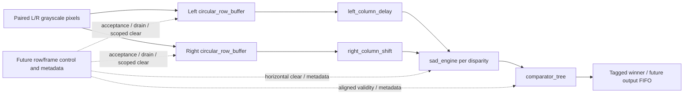

# Integration audit — serial baseline (historical)
#archived

> [!warning] Historical snapshot, not current implementation status
> Preserved from the serial row-storage audit and its repair update. References below to an unimplemented frontend/search, older case counts and proposed direct-wire timing describe that checkpoint only. See [[Integration Readiness]] for the current packed-load compute path and [[docs/verification/spare-row-prefetch|spare-row evidence]] for its measured limits.

[[Verification]] · [[Verification Map]] · [[Project Plan]] · [[Datapath Study Guide]]

## Verdict

**The existing arithmetic/storage components meet their tested functional contracts. The complete stereo accelerator does not yet meet its system requirements.** A small streaming integration milestone is justified; a board-ready, 640-wide, 32-lane design is not established.

This is a source-and-tool audit of the current working tree on **14 November 2026**, not a claim that the paper-design canvases have been implemented. The original [[Paper Design Plan.canvas|accelerator paper plan]] and [[Paper System Plan.canvas|system paper plan]] are preserved. The single active implementation route remains [[Project Plan]].

## Current row-storage review update

After the audit below, the row-storage block was repaired and checked independently: **eight bank cases, ten row cases including 640×480/641×480 streams, all 80 regression cases, all 16 targeted production-fault checks, and eight exact-source walkthroughs pass**. The real default row buffer now passes Analysis & Synthesis with **697 logic elements, 33 registers, 56,320 logical memory bits and 11 M9K RAM nodes**; see `docs/verification/row-buffer-synthesis.md`. This supersedes the old row-memory limitation below, not the unimplemented frontend/system requirements.

Current native Questa compilation passes. A fresh simulation is blocked by the already-open user's node-locked session; it was not closed. Current simulation results are Icarus, not a fresh native Questa claim. **User review comes before any next accelerator block or publishing; controller last.**

## Pre-repair audit execution evidence

The following original audit table and native simulation results are retained as historical evidence. The current row-store measurements are in the update above.

- `python scripts/check_walkthrough.py`: passed all seven registered exact-source walkthrough checks.
- `python scripts/run_tests.py`: passed the canonical **70 cases**: 64 self-checking SystemVerilog parameter cases and six Python-reference cases.
- `python scripts/check_test_sensitivity.py`: passed; all **12 deliberately introduced production-RTL faults** were rejected.
- **Native Questa Intel Starter FPGA Edition 2021.2: all 66 simulations passed.** This separate run exercised the same 64 SV parameter cases, with 2000 randomized cycles each, plus the beginner and seven-module worked-example benches. Every case has its own begin/end markers and scoreboard PASS in `questa-verified/transcript.log`; `summary.json` records the case list and source hashes. No Error/Fatal lines were reported. This does not turn the teaching bench into a complete accelerator integration test.
- Quartus Prime Lite **22.1std.0 Build 915**, target **EP4CE115F29C7**: fresh isolated Analysis & Synthesis runs on the existing sources. The scratch projects use one processor and existing compile-time defaults. They do not change the user's project settings.

| Synthesis top | Scope | Analysis & Synthesis | Logic elements | Dedicated registers | Inferred memory bits |
|---|---|---|---:|---:|---:|
| `column_sad` | K=11, P=8 | Pass; 0 errors, 0 warnings | 479 | 209 | 0 |
| `column_sum_buffer` | K=11, P=8 | Pass; 0 errors, 0 warnings | 292 | 159 | 0 |
| `sad_engine` | K=11, P=8; includes the two arithmetic/history components | Pass; 0 errors, 0 warnings | 770 | 368 | 0 |
| `left_column_delay` | K=11, P=8 | Pass; 0 errors, 0 warnings | 90 | 89 | 0 |
| `right_column_shift` | K=11, P=8, TAPS=32 | Pass; 0 errors, 0 warnings | 2883 | 2849 | 0 |
| `comparator_tree` | 32 lanes, 15-bit SAD, 5-bit IDs | Pass; 0 errors, 0 warnings | 1622 | 651 | 0 |
| `circular_row_buffer_synth` | **IMG_W=16**, K=11, P=8 smoke wrapper | Pass; 0 errors, 0 warnings | 3156 | 1510 | 0 |
| `circular_row_buffer` | **IMG_W=640**, K=11, P=8 functional default | **Did not complete within the bounded 120-second retry** | Not established | Not established | Not established |

At that audit, timeout meant incomplete synthesis, **not compiler rejection and not a pass**; the smoke had zero memory bits. The subsequent row-storage review above establishes full-width embedded-memory mapping. The failed attempts remain documented in [row-buffer-synthesis.md](../../docs/verification/row-buffer-synthesis.md).

These are **component pre-fit counts**, not fitted utilization or timing. Do not add the engine count to its child components, extrapolate a final 32-lane total from these runs, or mistake the thousands of internal tap-bus pins for a legal board pinout. No Fitter, TimeQuest timing closure, `.sof`, Nios V integration or board demonstration was performed in this audit.

Local raw evidence is under `build/integration-audit-gc24o2mc/`: `report.json`, the three canonical-check logs, and each top's `quartus_<top>.log` and `quartus/<top>/output_files/audit.map.summary`. Native Questa evidence is under `questa-verified/`. These generated artifacts are intentionally excluded from Git/Obsidian rather than presented as source.

## How the implemented pieces actually connect

Each `sad_engine` already contains `column_sad → column_sum_buffer`. These are **children of an engine**, not three independent stages to duplicate outside it. Only this engine composition and the separately tested delay/cache pairing are integrated today; the diagram's complete flow still needs wrappers and control.

### Interface and ownership rules

| Connection | Required contract |
|---|---|
| Paired input → two row buffers | One atomic accepted L/R pixel event. Both buffers advance or neither advances. Rectification is upstream. Existing component ports are valid-only; they have no backpressure input. |
| Row buffers → left delay / right cache | Registered vertical K-pixel columns, top pixel in element zero. At K=11/P=8 each column is **88 bits**. Pair valid signals; never advance only one image. |
| Left delay / right cache → lane d | After accepting column x, the registers expose **L[x]** and **R[x−d]**. A lane consumes them on the next edge, gated by `left_valid && tap_valid[d]`. Right taps are whole columns, not individual pixels or SAD costs. |
| Calculator → column history | Already wired inside `sad_engine`. Defaults: 12-bit column cost, 15-bit window cost. Maximum K=11/P=8 window SAD is **30855**, so 15 bits suffice. |
| Engine bank → comparator | Explicit valid/cost/disparity per lane, all belonging to the **same left-image coordinate and frame/row**. Defaults: 15-bit costs and 5-bit IDs for d=0…31. Ties choose the lower ID. |
| Comparator → output | Add aligned coordinates, row/frame identity, result validity and final-write accounting. The current comparator does not supply these tags. An output FIFO/ingress reservation scheme is required before a stalled memory interface is attached. |

Explicitly pass the engine's derived `SAD_W` into the comparator when K/P change; its fixed 15-bit default does not resize automatically. `D_W` must represent the actual global disparity IDs, including group-base offsets, not merely the physical lane count.

### Timing: do not drop the registered handoffs

Existing unit benches verify the engine's last-input-to-result offset of `ceil(log2(K)) + 1` edges. The comparator has `max(1, ceil(log2(LANES)))` registered levels; its first level samples on its input edge. Distinguish registered-stage count from an edge-index difference.

For **K=11, 32 lanes**, the following is the **derived schedule for a future direct-wire wrapper**, assuming a mature valid interior window, common clock and no extra registers. It is not an already simulated full-pipeline result:

| Edge | Event |
|---|---|
| E | Paired pixels accepted; row-buffer columns update after the edge. |
| E+1 | Left delay and right cache sample those columns. |
| E+2 | Engines sample aligned columns into difference registers. |
| E+6 | Column-SAD reduction output updates. |
| E+7 | Horizontal window-SAD outputs update. |
| E+8 | Comparator first level samples those lane results. |
| E+12 | Comparator final level updates the winner. |

A downstream register/FIFO consumes the newly updated winner on a later edge. Metadata must follow the actual clocked valid pipeline, including bubbles, rather than being shifted only on valid input. The integration bench must prove this schedule and revise it if the wrapper adds registers.

### Row-end and clear requirements

1. Detect the last **accepted paired pixel** of an image row and stop accepting the next row while horizontal work drains.
2. Allow the last registered row column, alignment stage, engine tree/history and reducer results to propagate. A five-edge engine-only drain is **not** a five-edge raw-pixel-to-winner drain.
3. Preserve both row buffers' K-row image history. Clearing them at every row destroys vertical windows.
4. Clear the right cache, left alignment validity, horizontal engine histories and matching metadata on a **separate edge after the required drain**. Account for the reducer and any output queue/commit state as well.
5. Resume input only when the next row can be accepted safely. Reset/frame abort may discard work; normal row completion must not do so.
6. Exercise rows/frames with no valid output too. A controller must not deadlock waiting for a winner that cannot exist during warmup or for an undersized valid region.

The row buffer's `row_last_o` is registered and exists only for vertically valid columns. A late sequential response to that marker can already accept a pixel from the next row. Use accepted-pixel/raster accounting or an explicitly timed boundary handshake to stop ingress, including during vertical warmup; verify the exact edge in the controller bench.

### Border policy to freeze before RTL

Recommended first integration policy: nonnegative disparity, no padding, costs from complete K×K windows, coordinates naming the **bottom-right left-image pixel**, deterministic lower-disparity ties, and a common interior when comparing the complete search range.

Lane d needs real columns starting at x≥d and first has a complete horizontal window at x≥d+K−1. **Do not delay feeding lane histories until the common interior**; that would create extra, incorrect warmup. Apply the common-region eligibility to the tagged results.

For the **illustrative** 640×480, K=11, d=0…31 case: all candidates are valid for x≥41 and y≥10. The corresponding cropped output is 599×470, or 281530 winners per frame. These are calculated contract expectations, not measured throughput or a completed frame test. A different border/coordinate policy must be explicitly specified and independently scored.

## Requirements assessment

| Requirement | Status | What remains |
|---|---|---|
| Existing seven high-level modules plus internal row RAM bank have exact-source walkthroughs and registered standalone benches | **Fulfilled** | Preserve this delivery rule for every new functional module. |
| SAD arithmetic, history/warmup, bubbles, clear priority, tap validity and comparator ties | **Fulfilled within current tests** | Run the same invariants through integration; tests are not an exhaustive proof. |
| Single engine calculator/history integration | **Fulfilled** | Full pixel-stream integration still absent. |
| Left-delay/right-cache pairing | **Fulfilled locally** | No dual-row-buffer/frontend integration bench yet. |
| Default arithmetic, cache and reducer component synthesis | **Fulfilled at Analysis & Synthesis only** | Fit/constrain the integrated implementation later. |
| Full-width row-storage simulation and M9K mapping | **Fulfilled at Analysis & Synthesis; user review pending** | Current row contract preserves output timing and ignores the written bank's collision value. Physical fitting, timing and stereo integration remain separate. |
| Complete frontend, coordinate metadata and row/frame controller | **Not implemented** | Paired acceptance, warmup, drain, scoped clears and tagged outputs. |
| Multi-disparity bank wired to the reducer | **Not implemented** | Same-coordinate scoring, masking, partial groups and end-to-end raw-pixel reference. |
| Smaller-bank reuse across a larger search range | **Not implemented** | Group scheduling and best-state merge; do not pretend a small lane count already searches all 32 disparities. |
| Ready/valid elasticity / stalled output handling | **Not implemented** | Reserve in-flight capacity or safely gate ingress; existing modules cannot simply be paused by deasserting output ready. |
| SDRAM/Avalon transport, CSRs and Nios V combined system | **Not implemented** | Platform proof, protocol tests, cache ownership, accepted-write completion. |
| Resource budget, fitted 50 MHz timing, full-frame speedup and board demonstration | **Not demonstrated** | Actual fit/STA and CPU/accelerator end-to-end comparison under the same memory/timing boundary. |

The system definition of done still requires **at least three `P_LANES` builds** with equal search settings, measured fMAX/resources/throughput/speedup, shared SDRAM and repeated frame batches ([design_hierarchy.md](../../docs/design_hierarchy.md#22-definition-of-done)). The row runner now accepts widths through 2048 and tests production-width frames; this closes storage gate 2, not those larger system requirements.

## Decision

**After user review:** freeze the frontend contract, then implement it and the one-lane datapath as separate reviewed blocks. The bank/reducer also precedes the final autonomous controller. Bench-supplied row gaps are not a controller implementation.

**Storage scale gate passed:** full-width memory mapping is measured. Still require integrated bank resources and actual fit/timing before calling a 640-wide multi-lane board implementation feasible.

**Parallel platform action now:** prove the intended external SDRAM region from the selected Nios V/toolchain baseline, then CSR and stalled pass-through transport, as required by the existing system report. This can proceed alongside simulated frontend work.

**Not yet:** connect the compute stream to an unverified memory system, assert 32-lane throughput, or replace verification with a successful standalone synthesis screenshot. See [[Project Plan#Audited implementation queue|the gated implementation queue]] for deliverables and stop/go tests.
